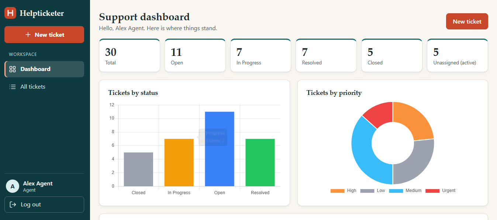
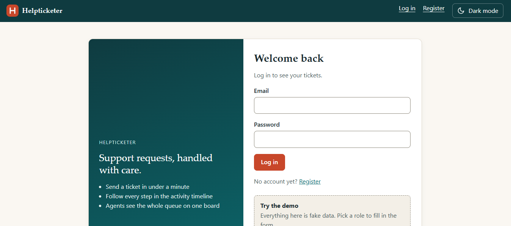
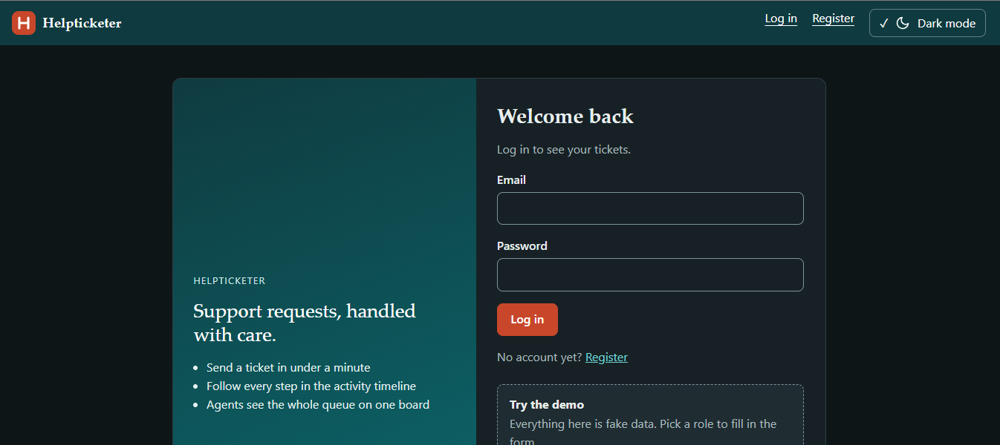
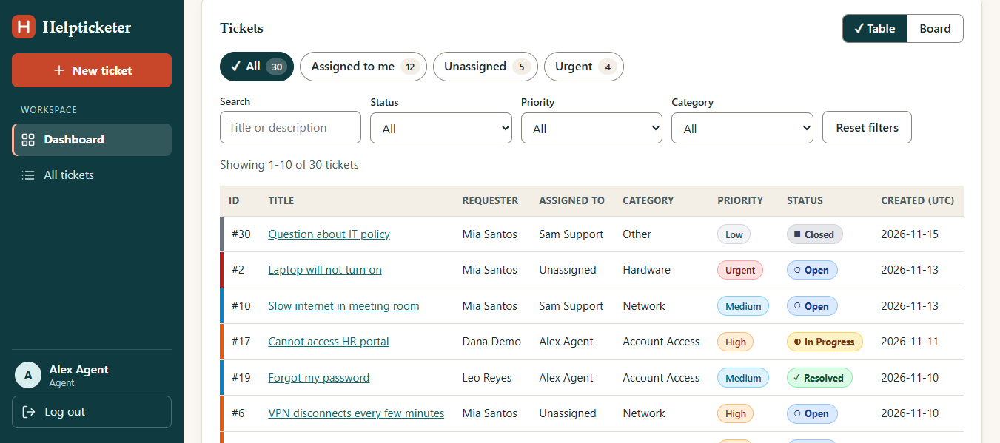
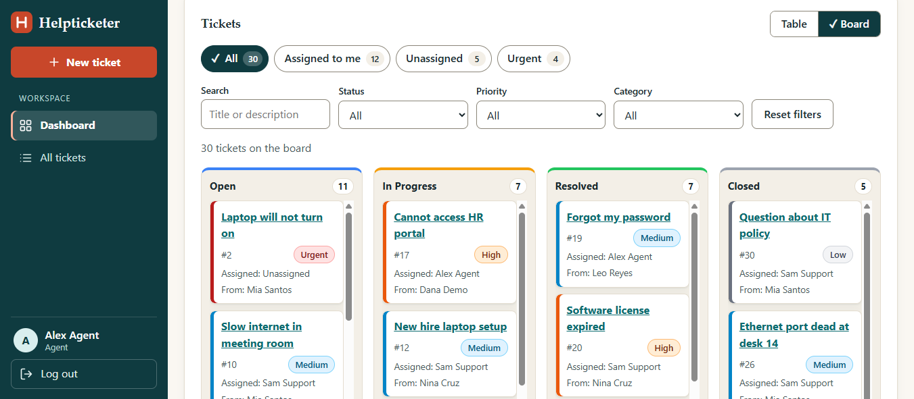
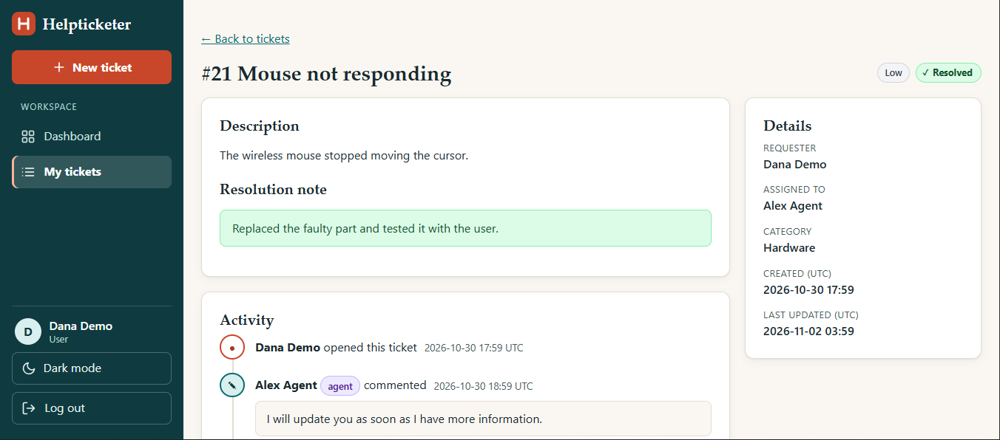
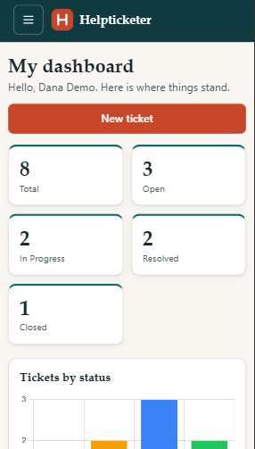
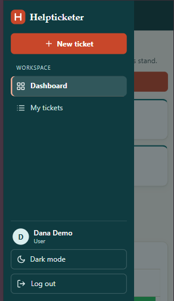
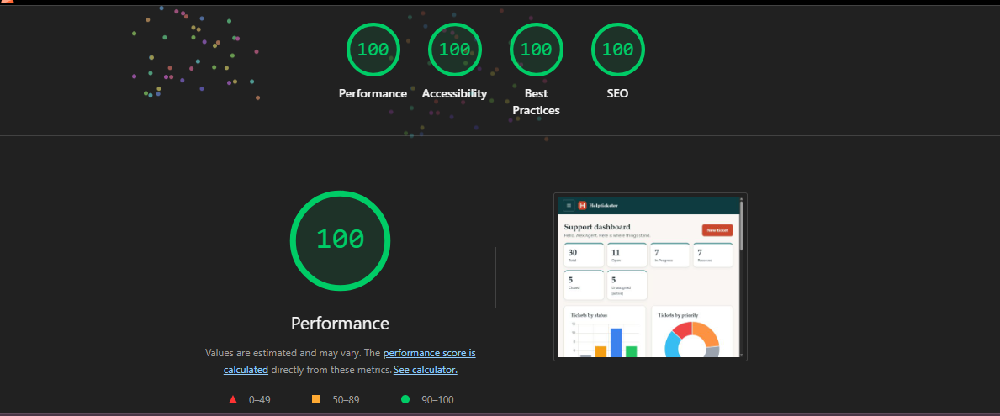

# Helpticketer

A small help desk web app. People send support tickets, agents and admins work through them, and every step is recorded in an activity timeline. It includes a REST API, an automated test suite, and an accessible, responsive interface with a dark theme.

**Live demo:** [[https://helpticketer.onrender.com/login]]
(The free demo host resets its data when it restarts, so the app re-loads fake demo data on startup.)



## Try it

The login page has a "Try the demo" box. All data is fake.

| Role | Email | Password |
|---|---|---|
| User | `user@demo.com` | `Demo1234!` |
| Agent | `agent@demo.com` | `Demo1234!` |
| Admin | `admin@demo.com` | `Demo1234!` |

## Features

- **Three roles.** Users, agents and admins. Anyone who registers becomes a user. Agents and admins are created by the server, never from a form field.
- **Tickets.** Title, description, category and priority. Users see only their own tickets. Staff see all of them.
- **Agent tools.** Assign tickets, change status, and write resolution notes.
- **Status workflow.** Open, In Progress, Resolved, Closed. Allowed moves are defined in one table. Resolving needs a note, and Closed is final.
- **Activity timeline.** Who opened, assigned, changed or commented, and when.
- **Dashboard.** Summary cards, charts (Chart.js), quick-filter chips with live counts, search, filters, paging, and a **Table / Board** toggle.
- **REST API.** Documented below, with consistent JSON errors.
- **Accessibility and design.** Skip link, labelled forms, errors linked to fields, keyboard-friendly menus, visible focus, light and dark themes, responsive down to phone width.

## Screenshots

| | |
|---|---|
|  |  |  | 
|  |  

Mobile view:

 


## Tech stack

- **Back end:** Python, Flask, Flask-SQLAlchemy (SQLite), Flask-Login, Flask-WTF
- **Front end:** Jinja templates, plain JavaScript (no framework), CSS variables, Chart.js
- **Testing:** pytest and pytest-cov
- **Deployment:** gunicorn on Render

## Run it locally (Windows PowerShell)

```powershell
git clone https://github.com/KaylDavid/helpticketer.git
cd helpticketer
python -m venv venv
.\venv\Scripts\Activate.ps1
pip install -r requirements.txt
flask --app wsgi reset-demo --yes
flask --app wsgi run --debug
```

Open http://127.0.0.1:5000 and log in with a demo account above.

Useful commands:

| Command | What it does |
|---|---|
| `flask --app wsgi reset-demo` | Deletes all data and reloads the fake demo data (asks first; `--yes` skips the question) |
| `flask --app wsgi seed-demo` | Loads demo data only if the database has no users |
| `flask --app wsgi create-user NAME EMAIL PASSWORD --role agent` | Creates a user with a specific role |
| `flask --app wsgi init-db` | Creates any missing tables without touching existing data |

## REST API

Send your email and password with **HTTP Basic Auth**. A browser login cookie also works for read-only `GET` requests, which is how the dashboard loads its data.

| Method and path | Who | What it does |
|---|---|---|
| `GET /api/me` | any | Who am I |
| `GET /api/tickets` | any | List tickets you may see |
| `POST /api/tickets` | any | Create a ticket |
| `GET /api/tickets/<id>` | any | One ticket with its comments |
| `POST /api/tickets/<id>/comments` | any | Add a comment |
| `PATCH /api/tickets/<id>/status` | staff | Change status (resolving needs `resolution_note`) |
| `PATCH /api/tickets/<id>/assignee` | staff | Assign with `{"assignee_id": 2}`, or unassign with `null` |
| `GET /api/stats` | any | Counts used by the dashboard |

**List filters:** `status`, `priority`, `category`, `q` (search), `assigned=me`, `unassigned=true` (active tickets nobody has picked up), `page`, `per_page` (1 to 50).

**Status codes:** `200`/`201` success, `400` body is not JSON, `401` not logged in, `403` role not allowed, `404` not found (or not yours to see), `405` wrong method, `409` a business rule was broken, `422` invalid value.

**Every error has the same shape:**

```json
{ "error": "Validation failed.", "fields": { "title": "Title must be 3 to 120 characters." } }
```

A Postman collection is in [`docs/postman/`](docs/postman/).

## How it is built

```
app/
  __init__.py        app factory, error handlers, CLI commands
  config.py          development / testing / production settings
  models.py          User, Ticket, Comment, TicketEvent
  permissions.py     role decorators and the "who can see this ticket" rule
  forms.py           web form rules
  blueprints/        auth, tickets (pages), dashboard, api (JSON)
  services/          business rules shared by the web pages and the API
  templates/ static/ HTML, CSS, JavaScript
tests/               pytest suite
```

Design decisions:

- **Business rules live in `services/`, not in routes.** The web pages and the API call the same functions, so a rule like "a Closed ticket cannot be reopened" exists once and is tested once.
- **App factory.** Each test builds its own app with an empty in-memory database, so tests cannot affect each other or real data.
- **Visibility is enforced in the database query.** A user's query only asks for their own rows. Another person's ticket returns `404`, not `403`, so its existence is not revealed.
- **The dashboard uses the public API.** The same endpoints are tested with Postman and pytest.
- **The board is read-only on purpose.** Drag and drop would need browser write access to the API, which is deliberately not allowed, and it would bypass rules that need a form (the resolution note).

## Security notes

- Passwords are hashed (Werkzeug's scrypt). Plain passwords are never stored.
- CSRF tokens protect every web form and the logout button.
- The API accepts writes only with Basic Auth, which browsers never attach on their own, so a login cookie cannot be used to change data through it. Tests prove this.
- Output is escaped by Jinja, and the dashboard JavaScript uses `textContent`, not `innerHTML`. There are tests with `<script>` in titles and comments.
- Redirect targets after login are checked (no open redirects).
- The login error is the same for an unknown email and a wrong password.
- Roles are never read from a form or JSON body. The requester and the comment author are set by the server.
- Search treats `%` and `_` as ordinary characters.
- Demo credentials are shown only when `SHOW_DEMO_LOGINS` is on (default off in production).

## Testing

```powershell
pytest -q                                      # run everything
pytest --cov=app --cov-report=term-missing -q  # with coverage
```

- **244 automated tests** covering authentication, permissions, validation, the status workflow, the REST API, the timeline, the board and form behaviour, and HTML accessibility checks.
- **Coverage: [[XX]]%.** The uncovered code is mostly the command-line seeding tools, which I checked by hand.
- Tests use boundary values (a title of 3 and 120 characters passes, 2 and 121 fail), check every allowed and forbidden status move, and include security tests.
- I broke rules on purpose during development (for example, letting a cookie write through the API) and confirmed the right tests failed.

**Accessibility:** automated structure tests plus manual keyboard and phone-width checks. 
|  | [lighthouse-score](docs/screenshots/lighthouse-login.png)

## Honest limitations

This is a portfolio project, not a production system.

- **SQLite** and no migration tool. Adding a table works with `init-db`, but changing existing columns would need Alembic.
- **No rate limiting** or account lockout on login.
- **Basic Auth** for the API is simple and fine behind HTTPS, but a larger API would use tokens.
- **No password reset, email notifications, or attachments.**
- **Admins and agents have the same ticket permissions.** There is no user-management page yet.
- **Times are shown in UTC.**
- The "My tickets / All tickets" page lists every visible ticket without paging. The dashboard has paging.
- The free demo host loses its data on restart. The app reloads fake demo data automatically.

## Ideas for later

Admin page to manage users and roles, CSV export, a knowledge base, SLA due dates with an overdue badge, email notifications, Alembic migrations, and Playwright end-to-end tests with GitHub Actions.

## What I learned

Designing a permission model that is enforced on the server, keeping business rules in one place, writing tests that can fail, and building accessible, responsive pages without a front-end framework. I built this with AI assistance and verified it by testing and debugging it myself. 
